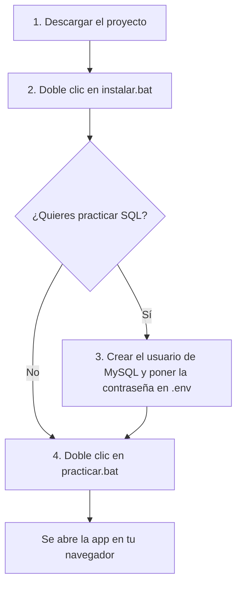
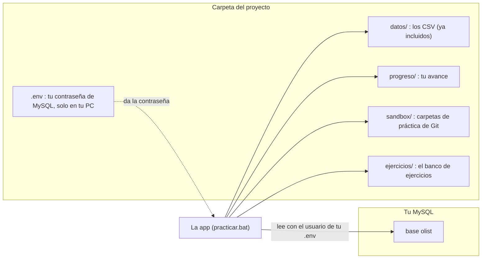
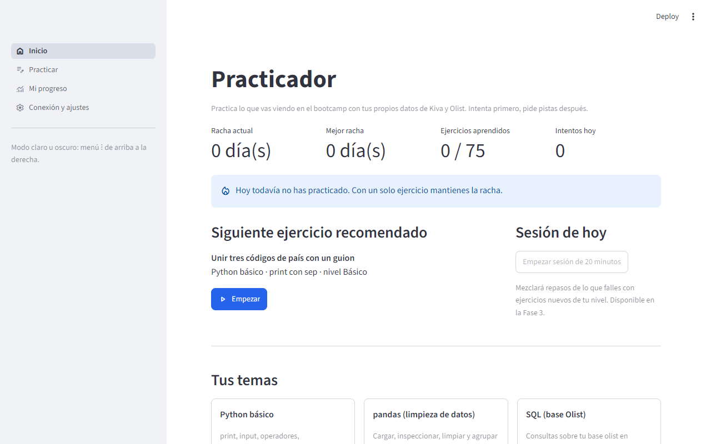
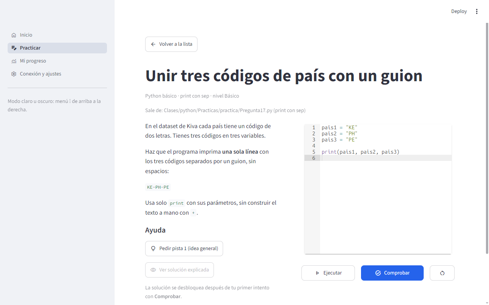
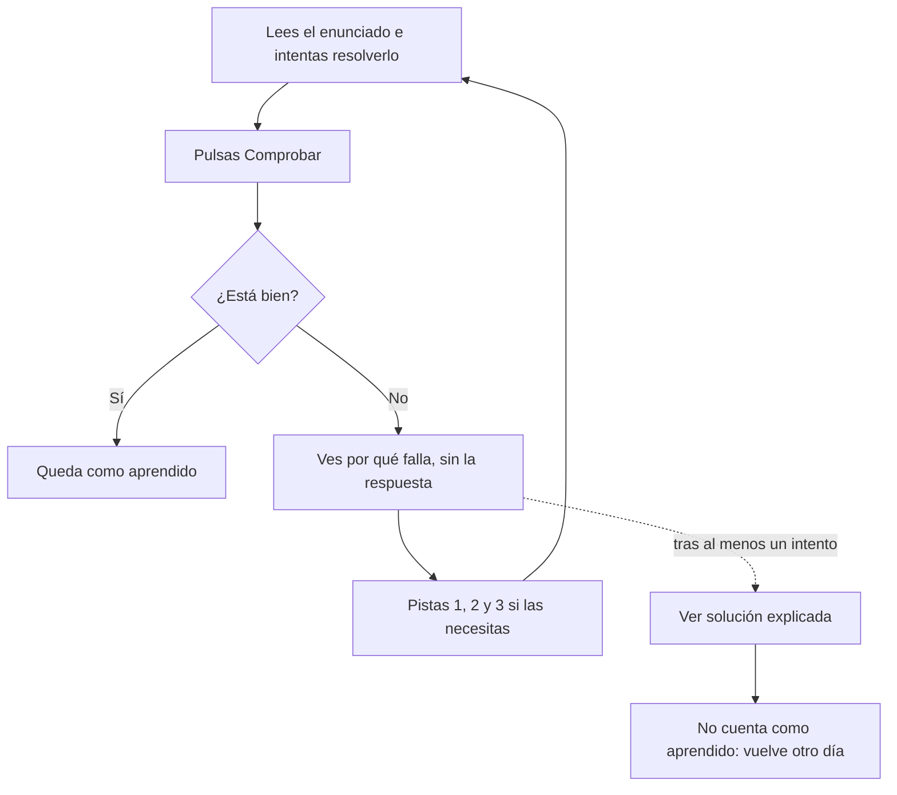
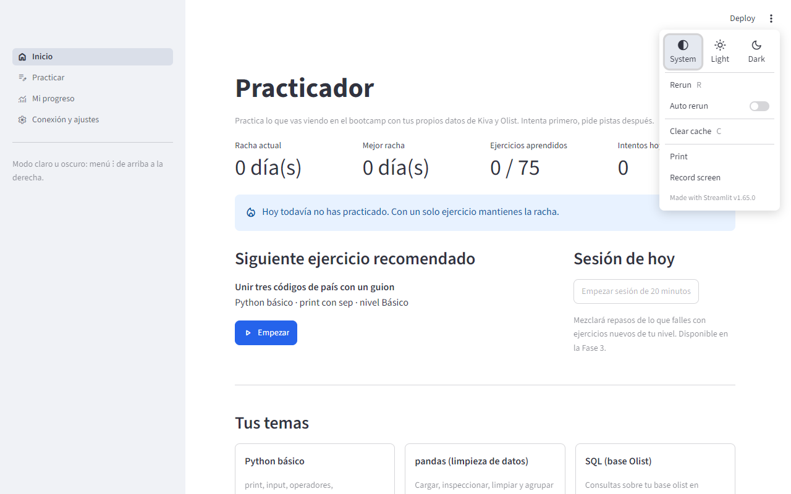

# Manual del Practicador

Guía rápida para instalar y usar el Practicador en tu ordenador.

## Qué es

Una app que se abre en tu navegador y te hace practicar lo que vemos en el bootcamp: **Python, pandas, SQL, Excel/Power Query y Terminal/Git**. Tú intentas el ejercicio, la app lo corrige, te explica por qué falla y te da pistas, pero **nunca te regala la solución**. Todo funciona en tu ordenador: no sube nada a internet y no necesita cuentas ni pagos.

## Qué necesitas

| Requisito | ¿Obligatorio? | Para qué sirve |
|---|---|---|
| Windows | Sí | La app y los `.bat` están pensados para Windows |
| [Python 3.13](https://www.python.org/downloads/) | Sí | Al instalarlo, marca **Add python.exe to PATH** |
| [Git for Windows](https://git-scm.com/downloads) | Sí | Descargar el proyecto y los ejercicios de Terminal/Git |
| MySQL 8 con la base `olist` (la del Proyecto IV) | No | Solo para los ejercicios de SQL |
| Excel de escritorio | No | Solo para los ejercicios de Excel y Power Query (no vale Excel web) |

Sin MySQL puedes hacer todo lo demás. Sin Excel puedes hacer todo menos esos ejercicios.

## Instalación de un vistazo



## Paso 1. Descargar el proyecto

Elige una de las dos formas:

- **Con Git Bash** (abre Git Bash en la carpeta donde quieras guardarlo):

  ```bash
  git clone https://github.com/fdrecabarren/Py_Practicador.git
  ```

- **Sin Git**: en la página del proyecto en GitHub pulsa **Code > Download ZIP** y descomprime.

Los datos que usan los ejercicios (CSV de Kiva, Olist y Customer_Activity) **ya vienen dentro** de la carpeta `datos/`. No tienes que buscarlos ni copiarlos.

## Paso 2. Instalar

Doble clic en **`instalar.bat`**. Crea el entorno de Python (`.venv`), instala las librerías y crea tu archivo `.env`. Tarda unos minutos, **solo la primera vez**. Cuando ponga "Listo", ya puedes cerrar esa ventana.

## Paso 3. Conectar MySQL (solo para SQL)

Si no vas a hacer ejercicios de SQL, salta al paso 4.

1. Comprueba que tienes la base `olist` con estas tablas: `orders`, `order_items`, `customers`, `order_payments`, `order_reviews`, `products`, `sellers` y `categoria_traduccion`. En MySQL Workbench, este comando debe dar **99441**:

   ```sql
   USE olist;
   SELECT COUNT(*) FROM orders;
   ```

2. Abre el archivo `.env` con el Bloc de notas y rellena el usuario y la contraseña con los que ya entras a tu MySQL (lo normal es `root`):

   ```
   DB_USER=root
   DB_PASSWORD=la_contraseña_que_usas_en_Workbench
   ```

   Guarda. Con esto basta. La app solo deja pasar consultas `SELECT` y `WITH`, y abre la conexión en modo solo lectura, así que no modifica tus tablas aunque uses `root`.
3. *(Opcional, más seguro)* Si prefieres no poner la contraseña de `root`, abre `scripts/usuario_mysql.sql` en Workbench, cambia la contraseña que trae y ejecútalo con `root`. Crea el usuario `practicador`, que solo puede leer la base `olist`. Entonces en `.env` pones `DB_USER=practicador` y esa contraseña.
4. Abre la app (paso 4), entra en **Conexión y ajustes** y pulsa el botón de probar la conexión.

> El archivo `.env` es solo tuyo. Git lo ignora y **no debes mandárselo a nadie**.

### Dónde está cada cosa



## Paso 4. Practicar

Doble clic en **`practicar.bat`**. Se abre una ventana negra (no la cierres mientras practicas) y la app aparece en tu navegador. Para terminar, cierra la ventana negra.



Elige un tema o pulsa **Empezar** en el ejercicio recomendado. La app solo escucha en tu propio ordenador (`127.0.0.1`), nadie más puede entrar.

## Cómo funciona un ejercicio





- **Ejecutar** (o **Revisar sin contar**) prueba tu trabajo y **no cuenta** como intento.
- **Comprobar** corrige y **sí cuenta** como intento.
- Un ejercicio está **aprendido** si lo resuelves sin ver la solución.
- Cada nivel (básico, intermedio, junior) se supera con un **70 %** de ejercicios aprendidos y hace falta tener superado el anterior.
- Si ves un mensaje de error, es el error **real** de Python o de MySQL: aprender a leerlo también es práctica.

### Excel y Power Query

1. La app te da un `.xlsx` de práctica con tus datos: lo descargas.
2. Lo resuelves en tu Excel y lo guardas con **Ctrl+G** (si no guardas, los valores calculados no se escriben en el archivo).
3. Lo subes en la app y te dice qué falta. Revisa los **valores** de las celdas, no cómo escribiste la fórmula.

### Terminal y Git

1. **Preparar ejercicio** crea una carpeta de práctica dentro de `sandbox/`.
2. **Abrir Git Bash aquí** abre una terminal dentro de esa carpeta. Los comandos los escribes tú.
3. **Comprobar** mira cómo ha quedado la carpeta.

Nunca toca tus repositorios reales: trabaja solo dentro de `sandbox/`.

## Modo oscuro

Menú **⋮** de arriba a la derecha > **Dark**. Con **System** sigue el tema de Windows. El navegador recuerda tu elección. Si cambias de tema con un ejercicio abierto, el editor de código se adapta al siguiente clic.



## Tu progreso

Se guarda en `progreso/progreso.db`, **solo en tu ordenador** (no se sube a GitHub y tus compañeros no lo ven). Puedes borrarlo desde **Mi progreso**.

## Actualizar a una versión nueva

- Si usaste Git, abre Git Bash en la carpeta y escribe `git pull`.
- Si descargaste el ZIP, descarga el nuevo y copia dentro tu carpeta `progreso/` y tu archivo `.env`.

## Problemas frecuentes

| Qué ves | Qué hacer |
|---|---|
| `py` o `python` no se reconoce | Reinstala Python 3.13 marcando **Add python.exe to PATH** y vuelve a ejecutar `instalar.bat` |
| "Falta configurar la conexión a MySQL" | Rellena `DB_PASSWORD` en `.env` (paso 3) |
| `Access denied for user` | El usuario o la contraseña de `.env` no son los que usas en Workbench (si pusiste `practicador`, comprueba que ejecutaste `usuario_mysql.sql` con esa misma contraseña) |
| `Table ... doesn't exist` | Tu base `olist` no tiene esa tabla o se llama distinto |
| "No encuentro Git Bash" | Instala Git for Windows |
| La app dice que faltan datasets | Ejecuta `git pull` o descarga el proyecto de nuevo: los CSV vienen incluidos |
| La ventana negra se cierra sola | Abre `practicar.bat` desde una terminal para ver el error y mándaselo a quien mantiene el proyecto |

## Para quien mantiene el proyecto

- Los ejercicios son archivos YAML en `ejercicios/`; el formato está en [`CLAUDE.md`](CLAUDE.md).
- Los CSV de `datos/` son muestras fijas: **no los modifiques** o se descuadran las soluciones. De dónde sale cada uno está en [`datos/LEEME.md`](datos/LEEME.md).
- Más detalle técnico en el [`README.md`](README.md).
